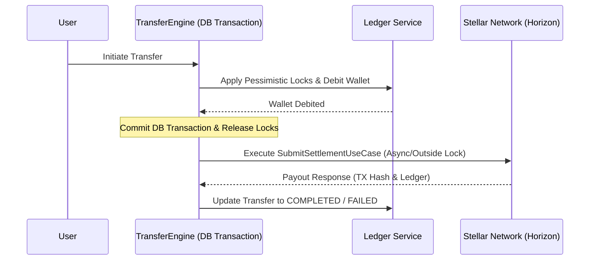

# Blockchain Settlement Module Reference

This document provides a technical guide to the Stellar Blockchain Settlement module within FactoPay, detailing how it works, how it is wired into the Transfer Engine, its security controls, and how the administrative features operate.

---

## 1. Module Overview

The `BlockchainSettlementModule` handles the on-chain settlement layer on the **Stellar Network** (Testnet for MVP, Mainnet for Production). It wraps all blockchain interactions behind a domain interface (`IStellarGateway`), insulating the rest of the application from Stellar primitives (e.g. keypairs, Horizon SDK, XDR envelopes, and trustlines).

### Core Wallet Architecture
Stellar operations utilize four system roles whose keys are loaded securely:
1. **Master Wallet (`MASTER`)**: Holds the primary liquidity pool for outgoing user transfers.
2. **Fee Wallet (`FEE`)**: Receives captured transaction margins and network gas fees.
3. **Liquidity Wallet (`LIQUIDITY`)**: Buffer pool for incoming funding and conversions.
4. **Issuer Wallet (`ISSUER`)**: Testnet mock USDC issuer (non-production).

---

## 2. Technical Component Architecture

The module lives under `src/modules/blockchain-settlement/` and adheres to a Clean Hexagonal Architecture:

```
src/modules/blockchain-settlement/
├── domain/
│   ├── gateways/
│   │   └── stellar-gateway.interface.ts   # Port interface for StellarService
│   ├── repositories/
│   │   └── blockchain-repository.interface.ts # Decoupled persistence contract
│   ├── models/
│   │   └── memo-resolver.ts               # Router resolving anchor memos
│   └── errors/
│       └── blockchain-errors.ts           # Shared error definitions & codes
├── application/
│   ├── dtos/                              # Validation schemas for requests/queries
│   └── use-cases/                         # Pure business actions
└── infrastructure/
    ├── controllers/                       # REST endpoints (restricted by RBAC)
    ├── persistence/                       # Prisma DB repository wrapper
    ├── adapters/
    │   └── stellar.service.ts             # Stellar SDK integration adapter
    └── security/                          # AML allowlists, limits, & locks
        ├── wallet-crypt.ts                # AES-256-GCM seed encryption
        ├── wallet-lock.manager.ts         # Hybrid Redis + Mutex sequence locks
        ├── settlement-limits.service.ts   # Limit verification
        └── destination-allowlist.service.ts # Allowed destinations AML check
```

---

## 3. Core Architectural Upgrades

### 3.1 Hexagonal Decoupling
To enforce architectural boundaries, all use cases now interact only with the `IBlockchainRepository` port interface. The concrete `PrismaBlockchainRepository` is bound to the `BLOCKCHAIN_REPOSITORY_TOKEN` at runtime.

### 3.2 Dynamic Congestion Fee Buffering
Dynamic base fees on Stellar rise during network congestion. To prevent transaction drops, `StellarService` computes fees dynamically:
- It queries the Horizon network's current base fee.
- Applies a configurable multiplier (`STELLAR_FEE_MULTIPLIER` - default `1.5`).
- Enforces an absolute cap (`STELLAR_MAX_BASE_FEE` - default `1000` stroops / `0.0001 XLM`) to prevent overpaying during freak fee anomalies.

### 3.3 Sequence Number Auto-Retry Loop
Stellar transactions fail with `tx_bad_seq` if the sequence number is out of sync. To resolve this, transaction building and submission are wrapped in a 2-attempt retry loop:
- If a sequence error is caught, the service automatically refreshes the sender's account sequence from Horizon.
- Re-builds, re-signs, and re-submits the transaction instantly.

### 3.4 Hybrid Redis Lock Manager (`WalletLockManager`)
Stellar sequence numbers must be accessed sequentially.
- Local in-memory mutex locks (`async-mutex`) serialize calls within a single Node.js process.
- Distributed Redis locks (`setNxWithExpiry` locks) extend this safety across horizontally scaled pods.
- If Redis is down, the lock manager gracefully falls back to local-only locking with log alerts, keeping the system operational.

---

## 4. Mainnet Bootstrapping & Reserve Sponsorship

In the Stellar Testnet environment, we initialize accounts via Friendbot. When transitioning to **Mainnet**, this mechanism must be replaced with the following production procedures:

### 4.1 Native Account Initialization
- Creating a keypair generates a cryptographic public/private key, but the account does not exist on the Stellar ledger until it is funded.
- To bootstrap a custodial user wallet on Mainnet, the `MASTER` or `FEE` wallet must submit a transaction containing a **Create Account** operation sending a minimum of `1.5` to `2.0 XLM` to the new public key.

### 4.2 Fee & Reserve Sponsorship (Zero-Balance Custody)
Stellar requires a minimum reserve of `0.5 XLM` for every trustline established (such as trusting the USDC asset). Keeping XLM on every user wallet is expensive and operationally complex.
- **Sponsorship Mechanism**: Wrap trustline operations inside a reserve sponsorship envelope.
- The `MASTER` or `FEE` wallet signs a `BeginSponsoringFutureReserves` operation, followed by the user wallet's `ChangeTrust` operation, and concludes with `EndSponsoringFutureReserves`.
- This binds the lock-up reserve to the master account, allowing user custodial wallets to carry a `0` XLM balance while retaining full USDC transaction capability.

---

## 5. Transfer Engine Integration & Non-Blocking Design

The settlement module integrates into the main remittance flow inside `InitiateTransferUseCase`.

### Critical Database Safety (Non-Blocking Design)
To prevent active database transactions from starving the database connection pool during slow Stellar Horizon HTTP calls (which can take 3–10 seconds), the workflow explicitly releases database locks before invoking Stellar:



### Flow Execution States
1. **Ledger Execution**: The user's local balance is locked and debited inside a Prisma `$transaction` block.
2. **Release locks**: The database transaction commits and all pessimistic row-locks are released.
3. **Blockchain Settlement**: The use case triggers `SubmitSettlementUseCase.execute()`.
   * **Success**: If Stellar returns a valid transaction hash and ledger block, the transfer status is updated to `COMPLETED`.
   * **Verify Needed**: If Stellar Horizon returns a pending or timeout status, the transfer is marked as `PENDING_VERIFICATION`.
   * **Failure**: If Stellar throws a transaction/network error, the transfer status is marked as `FAILED`.

---

## 6. Administrative Features & Endpoints

All admin endpoints are served under `/blockchain/` and secured by `JwtAuthGuard` and `RolesGuard`.

### Endpoint Directory

| Method | Route | Allowed Roles | Description |
|---|---|---|---|
| `GET` | `/blockchain/transactions` | `SUPPORT`, `ADMIN`, `SUPERADMIN` | Lists paginated blockchain transactions (with search/filters). |
| `GET` | `/blockchain/wallets` | `ADMIN`, `SUPERADMIN` | Lists paginated user custodial wallets (redacts `encryptedSecret`). |
| `POST` | `/blockchain/wallets/provision` | `ADMIN`, `SUPERADMIN` | Provisions a new custodial wallet for a user. |
| `GET` | `/blockchain/transactions/:id` | `SUPPORT`, `ADMIN`, `SUPERADMIN` | Retrieves details for a specific transaction. |
| `GET` | `/blockchain/wallets/:role/health` | `ADMIN`, `SUPERADMIN` | Fetches live XLM/USDC balance and trustline status for system roles. |
| `POST` | `/blockchain/send` | `ADMIN`, `SUPERADMIN` | Manually triggers a USDC payout submission to Stellar. |
| `POST` | `/blockchain/transactions/:id/verify` | `ADMIN`, `SUPERADMIN` | Re-polls Horizon to resolve a pending (`PENDING_VERIFICATION`) status. |
| `POST` | `/blockchain/testnet/mint` | `SUPERADMIN` | Mints test USDC (available on TESTNET mode only). |

### Security Safeguards
* **Encrypted Secrets Redaction**: `GET /blockchain/wallets` sanitizes the records from the `StellarWallet` model by removing the `encryptedSecret` field and returning only public keys and metadata, preventing private key leaks through admin panels.
* **Audit Logging**: Successful payouts, verification actions, and minting operations trigger administrative audit records saved to the database.

---

## 7. Data Models

### 7.1 `BlockchainTransaction`
Represents the log of an on-chain transaction.
* `id` (UUID): Primary key.
* `transferId` (UUID, Unique): Links directly to the remittance transfer model.
* `sourceAddress` (String): The public key of the sending wallet (e.g. `MASTER`).
* `destAddress` (String): The recipient anchor or user address.
* `amount` (Decimal): Payout amount in USDC.
* `memo` (String, Optional): Routing ID matched by destination anchors.
* `status` (Enum): `PENDING`, `PENDING_VERIFICATION`, `SUCCESS`, `FAILED`.
* `txHash` (String, Optional): On-chain transaction transaction hash.
* `ledger` (Int, Optional): The block number where the transaction was settled.

### 7.2 `StellarWallet`
Represents a custodial wallet assigned to a specific user.
* `id` (UUID): Primary key.
* `userId` (UUID, Unique): Links the wallet to a user.
* `publicKey` (String, Unique): Stellar public key.
* `encryptedSecret` (String): AES-256-GCM encrypted secret key.
* `hasTrustline` (Boolean): Flag representing whether the USDC trustline has been opened.
* `isActive` (Boolean): Active status.

---

## 8. Environment Setup Requirements

For the settlement system to function, the following environment variables must be populated inside `.env`:

```env
# Stellar Gateway Configuration
STELLAR_NETWORK_PASSPHRASE="Test SDF Network ; September 2015" # OR "Public Global Stellar Network ; October 2015"
STELLAR_HORIZON_URL="https://horizon-testnet.stellar.org" # OR "https://horizon.stellar.org"
STELLAR_WALLET_ENCRYPTION_KEY="your-secure-32-byte-key-phrase" # For crypt/decrypt of custodial keys

# Stellar Issuer addresses (USDC)
STELLAR_USDC_ISSUER_PUBLIC="GBBD47IF6LWK7P7TZS2ADQDPTO2DMTM26IE6XYVJ65P3ENW6CIH2WCNR"
STELLAR_MIN_XLM_RESERVE="50"

# System Account Seeds (Must be funded for testnet)
STELLAR_MASTER_PUBLIC="GMASTER..."
STELLAR_MASTER_SECRET="SMASTER..."
STELLAR_FEE_PUBLIC="GFEE..."
STELLAR_FEE_SECRET="SFEE..."
STELLAR_LIQUIDITY_PUBLIC="GLIQUIDITY..."
STELLAR_LIQUIDITY_SECRET="SLIQUIDITY..."
STELLAR_USDC_ISSUER_SECRET="SISSUER..." # Only used on Testnet mock minting

# Dynamic Fees
STELLAR_FEE_MULTIPLIER="1.5"
STELLAR_MAX_BASE_FEE="1000"
```
