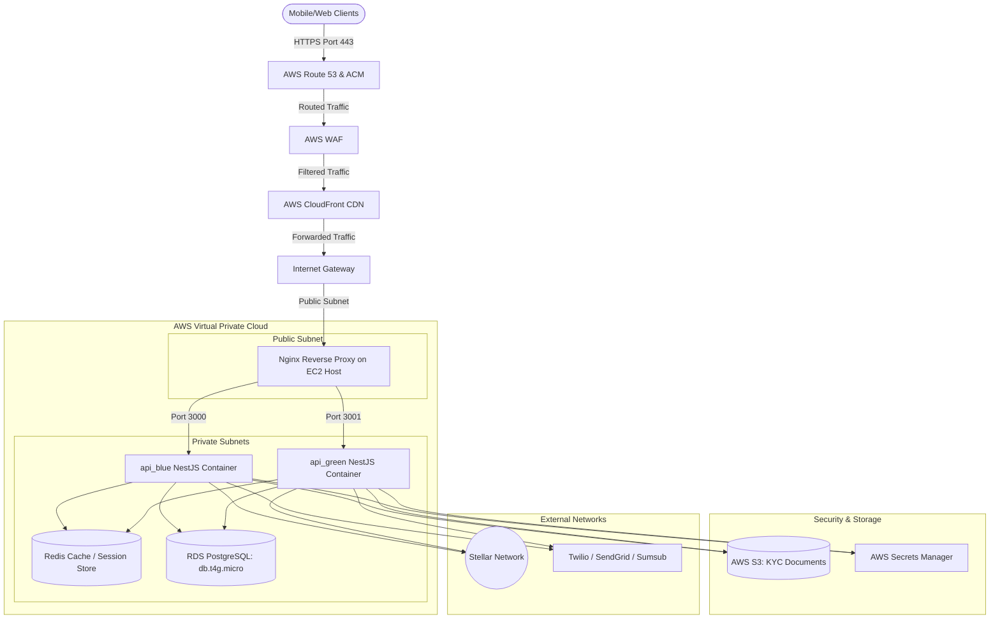

# FactoPay Production Cloud Architecture & Cost Estimation
**Prepared by:** Barabu Oscar Edem (Backend and DevOps Engineer)  
**Target:** FactoPay Management  
**Status:** Architecture Proposal & Financial Projection  

---

## 1. Cloud Architecture Overview

FactoPay's cloud architecture is designed for **high availability, zero-downtime container swaps, and network-level security isolation**.

### Key Components:
1. **AWS Route 53 & ACM**: Manages DNS resolution and validates wildcard SSL/TLS certificates for the backend API domain.
2. **AWS WAF**: Web Application Firewall directly associated with the CloudFront CDN, filtering out SQL injection, bad bots, and DDoS attempts.
3. **AWS CloudFront**: Edge proxy CDN that offloads SSL encryption overhead and delivers responses globally, restricting inbound EC2 access strictly to CloudFront origin IPs.
4. **Public Subnet (EC2 & Nginx)**: Host-level Nginx acts as the boundary gateway router, routing traffic to the active API container.
5. **Amazon RDS PostgreSQL**: Managed transactional database deployed securely in a private subnet, accepting connections ONLY from the EC2 security group.

---

## 2. Infrastructure Cost Estimation

We present two hosting tiers depending on business transaction volume and SLA requirements.

### Tier A: MVP / Startup Setup (AWS Native Edge & AWS RDS PostgreSQL)
*Optimal for initial launch and development. Relies on self-hosting the cache inside Docker, a single-node db.t4g.micro RDS database, and AWS free-tier CloudFront limits to keep monthly spend minimum.*

| Cloud Resource | Configuration Specification | Estimated Monthly Cost (USD) | Rationale |
| :--- | :--- | :--- | :--- |
| **AWS Compute (EC2)** | 1x `t3.micro` (1 vCPU, 1GB RAM) | ~$8.50 | Running Blue/Green API instances and a self-hosted Redis container. |
| **Relational Database** | AWS RDS PostgreSQL (`db.t4g.micro`, 20GB GP3) | ~$15.00 | Single Availability Zone database. Automated backups. |
| **AWS S3 Storage** | 10 GB Storage + standard requests | ~$0.50 | Standard storage for user KYC documents. |
| **AWS Secrets Manager** | 1 Secret group, infrequent calls | ~$0.40 | Secure credentials store. |
| **AWS Route 53 & ACM** | 1 Hosted Zone + Free SSL cert | $0.50 | Domain name registration & certificate routing. |
| **AWS CloudFront** | AWS Free Tier (Under 1 TB egress) | $0.00 | Content Delivery Network and edge proxy. |
| **AWS WAF** | 1 Web ACL + 1 Core rule group | ~$6.00 | Protects against malicious scripts and HTTP floods. |
| **Data Transfer Fees** | ~$0.09 / GB | ~$2.00 | Standard egress/ingress charges. |
| **Total Estimated MVP Cost** | | **~$32.40 / month** | |

---

### Tier B: Production-Grade / Scale Setup (High Availability & Managed Services)
*Optimal for scale, offering high redundancy, automated backups, and dedicated caching.*

| Cloud Resource | Configuration Specification | Estimated Monthly Cost (USD) | Rationale |
| :--- | :--- | :--- | :--- |
| **AWS Compute (EC2)** | 1x `t3.medium` (2 vCPU, 4GB RAM) | ~$34.00 | Dedicated instance to support concurrent blue/green transactions safely. |
| **AWS RDS (PostgreSQL)** | `db.t4g.micro` Multi-AZ, 20GB GP3 | ~$35.00 | Managed database with replication, automated failover, and daily snapshots. |
| **AWS ElastiCache (Redis)** | `cache.t4g.micro` (Single Node) | ~$12.00 | Managed Redis for FX quote cache and idempotency lock validation. |
| **AWS S3 Storage** | 100 GB Storage + Versioning enabled | ~$3.00 | Secure file hosting for larger user document volumes. |
| **AWS Secrets Manager** | 1 Secret group, SDK fetch checks | ~$0.40 | Encrypted credentials access. |
| **AWS NAT Gateway** | 1x NAT Gateway + Data Transfer | ~$32.00 | Routes outbound calls from private subnets (SaaS, Stellar) securely. |
| **AWS Route 53 & ACM** | 1 Hosted Zone + Free SSL cert | $0.50 | Domain name registration & certificate routing. |
| **AWS CloudFront** | Standard pricing (under 2 TB egress) | ~$5.00 | Global distribution and proxy edge caching. |
| **AWS WAF** | 1 Web ACL + 3 Advanced rule groups | ~$15.00 | Fine-tuned rate limiting and geographic SQL injection protection rules. |
| **Total Production Cost** | | **~$136.90 / month** | |

---

## 3. Third-Party SaaS Cost Profile

These costs scale linearly with user acquisition and transaction volumes.

* **Sumsub (KYC)**:
  * *Pricing*: Pay-as-you-go per verification.
  * *Estimate*: ~$1.30 to $1.80 per approved user check.
* **Twilio (SMS OTP)**:
  * *Pricing*: ~$0.0079 per SMS sent (varies by region).
  * *Estimate*: ~$7.90 per 1,000 sent SMS messages.
* **SendGrid (Email)**:
  * *Pricing*: Free tier up to 100 emails/day; paid plans start at $19.95/month.
  * *Estimate*: $19.95/month for up to 50,000 emails/month.
