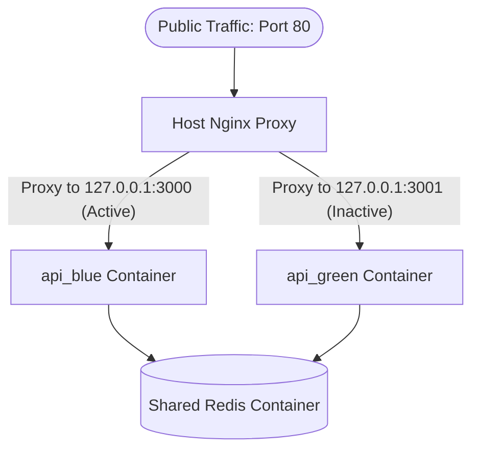

# FactoPay — Production Deployment & Rollback Guide

This guide documents the **Container-Level Blue-Green Zero-Downtime Deployment Architecture** and CI/CD operations setup for FactoPay.

---

## 1. Deployment Architecture Overview

To eliminate downtime during pushes, the production environment on the EC2 host runs a twin-container setup with a host-level Nginx reverse proxy.



### Key Technical Details:
* **Twin Engines:** `api_blue` (Host Port `3000`) and `api_green` (Host Port `3001`) run identical copies of the NestJS application.
* **Shared State (Redis):** A single background container (`factopay_redis`) acts as the state broker for both Blue and Green instances. Active user logins, rate-limit buckets, and idempotency lock mappings are preserved 100% intact across deployments, ensuring **zero forced logouts** or lost webhook events when pushing code.
* **Nginx Router:** A host-level Nginx proxy receives public HTTPS traffic (via Amazon CloudFront) and forwards it to the active container's port.

---

## 2. API Versioning Setup

All API endpoints are explicitly versioned under the `/api/v1/...` prefix to prepare for future feature additions without breaking backward compatibility.

* **Prefix Enforcement:** Setup globally in `src/main.ts` using `app.setGlobalPrefix('api/v1')`.
* **API Endpoints:**
  * KYC Management: `/api/v1/kyc/...`
  * Transfer Engine: `/api/v1/transfers/...`
  * Auth & Profile: `/api/v1/auth/...`

---

## 3. Automated CI/CD Push Workflow

Deployments are automated on push to the `main` branch via GitHub Actions (`.github/workflows/deploy.yml`):

1. **Build & Tag ECR:** The runner builds the production Docker image, tags it with the **Git Commit SHA** (e.g. `c4b12e3`) and `latest`, and pushes it to Amazon ECR.
2. **SCP Files Transfer:** Transfers `docker-compose.prod.yml` and the `scripts/` directory to `~/app` on the EC2 host.
3. **SSH Execution:** Connects via SSH to the EC2 host and executes:
   ```bash
   cd ~/app && bash scripts/deploy.sh
   ```

---

## 4. One-Time EC2 Server Setup

Before your first deployment, run the initialization script once on your EC2 host:

```bash
# 1. SSH into your newly provisioned EC2 server (retrieve EIP from terraform outputs)
ssh -i <your_key.pem> ec2-user@<your_ec2_public_eip>

# 2. Prepare app directories on the host
mkdir -p ~/app/scripts
mkdir -p ~/app/nginx

# 3. Securely upload the files in /scripts and docker-compose.prod.yml to ~/app
# 4. Run the one-time provisioning script
bash ./scripts/setup-server.sh
```

---

## 5. Rollback Playbook

If a newly deployed version exhibits issues in production, you have two rollback options.

### Option A: Emergency Instant Rollback (Zero Downtime)
Use this if the new version is broken and you need to revert to the previously running pre-warmed container **instantly** (under 3 seconds).

```bash
# 1. SSH into the EC2 Server
cd ~/app

# 2. Run the rollback script
bash ./scripts/rollback.sh
```
* **What it does:** It immediately restarts the older container version residing on the host, re-points the Nginx upstream config to its port, reloads Nginx, and halts the buggy container.

### Option B: Specific Version Rollback (ECR Tag)
Use this to redeploy **any specific historical Git commit** from your Amazon ECR registry.

```bash
# 1. Locate the Git Commit SHA you want to deploy (e.g. 84bcbe4)
# 2. SSH into the EC2 Server
cd ~/app

# 3. Set the target IMAGE_TAG and execute the deploy script
export IMAGE_TAG=84bcbe4
bash ./scripts/deploy.sh
```

---

## 6. Production Safety Features

### Container Memory Limits
To protect the `t3.micro` EC2 instance (1GB RAM) from out-of-memory crashes:
* Each API container (`api_blue` / `api_green`) is capped at **450MB**.
* The Redis container is capped at **128MB**.
* Only one API container runs at a time in steady state, leaving headroom for the OS and Nginx.

### Log Rotation
Docker container logs are automatically rotated to prevent disk exhaustion:
* **Max file size:** 10MB per log file
* **Max files retained:** 3 rolling files per container
* Total log footprint per container: ≤ 30MB

### Old Image Cleanup
After every successful deployment, the script automatically prunes dangling Docker images older than 72 hours, preventing stale layers from accumulating and filling up the EC2 disk.
