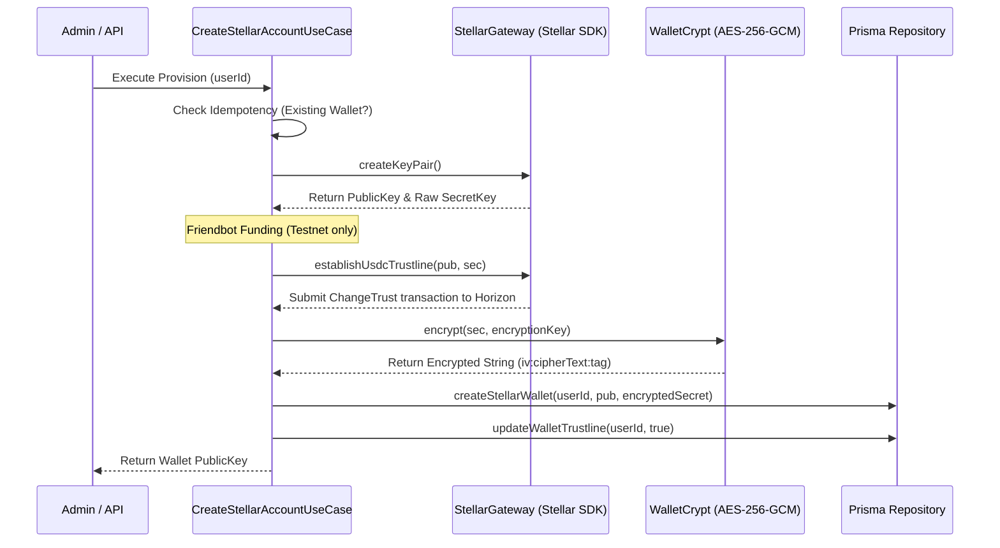
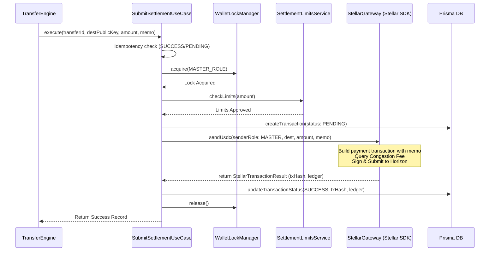

# FactoPay: Stellar Blockchain & USDC Settlement Integration Guide

This guide provides a comprehensive overview of how the **Stellar Network** and **USDC stablecoin** are utilized within the **FactoPay** platform for cross-border remittances, payment settlement, and custodial wallet custody.

---

## 1. Architectural Role & Philosophy
FactoPay uses a **layered, clean hexagonal architecture** where all blockchain-related tasks are encapsulated inside the `BlockchainSettlementModule`. 
- **Decoupled Gateway Interface (`IStellarGateway`)**: Use cases interact only with the gateway interface. This protects the core application layer from low-level Stellar SDK operations, transaction formatting, Horizon HTTP requests, and raw key manipulation.
- **On-Chain Settlement**: Cross-border transfers from Europe/America are converted and settled to target corridors (e.g., Nigeria, Kenya) via the **Stellar Network** using **USDC stablecoins** to ensure 5-second finality and near-zero fees.

---

## 2. Custodial Wallet Roles & Hierarchy
System transactions utilize four primary system roles configured through environment variables:

| Wallet Role | Code Identifier | Description |
|---|---|---|
| **Master Wallet** | `MASTER` | Holds primary USDC liquidity used for outbound payouts to payout partner anchors. |
| **Fee Wallet** | `FEE` | Accumulates captured platform margins, transaction premiums, and XLM gas fees. |
| **Liquidity Wallet** | `LIQUIDITY` | Serves as a buffer pool for inbound funding, conversions, and treasury operations. |
| **Issuer Wallet** | `ISSUER` | Mocks the official USDC issuance address on the Stellar Testnet (disabled on Mainnet). |

---

## 3. Custodial User Wallet Provisioning Workflow
When a new user is onboarded, a custodial Stellar wallet is created to store funds, receive deposits, or process transactions.



### Steps in Custodial Wallet Provisioning:
1. **Idempotency Check**: The use case verifies whether a wallet already exists for the user in the database.
2. **Keypair Generation**: Uses `Keypair.random()` from the Stellar SDK to generate a new public key (`G...`) and secret key (`S...`).
3. **Account Funding**: On Testnet, the account is funded via the Stellar Friendbot (`https://friendbot.stellar.org`) to instantiate it on the ledger.
4. **Establish USDC Trustline**: A `ChangeTrust` operation targeting the USDC asset (issued by the designated system issuer) is built, signed with the user's secret key, and submitted to the Stellar network to allow the wallet to hold USDC.
5. **Symmetric Encryption**: The secret key is encrypted via `AES-256-GCM` using the `STELLAR_WALLET_ENCRYPTION_KEY` environment variable.
6. **DB Persistence**: The public key and encrypted secret (formatted as `iv:cipherText:tag`) are saved to the `StellarWallet` table.
7. **Trustline Flag Update**: The trustline status is updated to `true`.

---

## 4. Remittance & Settlement Flow
When a user initiates a cross-border transfer, the **Transfer Engine** handles debiting and locks before delegating payment submission to the **Blockchain Settlement Module**.

### Non-Blocking Database Lock Design
Stellar Horizon HTTP submissions can take 3 to 10 seconds. To prevent database connection pool starvation and lock contention:
1. **Ledger Debit**: The sender's local fiat/crypto balance is debited and locked within a short, pessimistic database transaction.
2. **DB Commit**: The database transaction is committed, and all pessimistic row-locks are released immediately.
3. **Out-of-Transaction Submission**: The system invokes `SubmitSettlementUseCase` outside the database transaction context.
4. **On-Chain Payout**: The master wallet signs a USDC payment transaction and broadcasts it to Horizon.
5. **Async Completion**: On success, the transfer is marked `COMPLETED` and the TX hash/ledger block is recorded.



---

## 5. Security & Risk Controls

### 5.1 Symmetric Secret Key Protection (`WalletCrypt`)
Custodial user wallets have their secret keys encrypted using AES-256-GCM with a SHA-256 derived key from the environment secret:
- Key derivation: `crypto.createHash('sha256').update(passphrase).digest()`
- Output format: `${iv.toString('hex')}:${encryptedText.toString('hex')}:${authTag.toString('hex')}`
- Verification during decryptions enforces auth tag validation. If the key is modified, decryption fails immediately.

### 5.2 Log & Error Sanitization (`StellarLogSanitizer`)
To prevent private key leakage to application logs, APMs, or API responses, a custom sanitizer parses strings, objects, and Error stack traces, replacing any Stellar secret keys matching `/S[A-Z2-7]{55}/g` with `[REDACTED_STELLAR_SECRET]`.

### 5.3 AML Destination Allowlisting
Before any on-chain payment is built, the system queries the `DestinationAllowlistService`, which verifies the destination public key against the `STELLAR_ALLOWED_DESTINATIONS` list (defined in the environments file for approved corridors/anchors). Transactions to unapproved addresses are blocked immediately.

### 5.4 Settlement Limits (`SettlementLimitsService`)
Verifies transaction values against dual ceilings:
1. **Single Transaction ceiling**: Checked against `STELLAR_MAX_TX_AMOUNT` (defaults to 10,000 USDC).
2. **Daily Aggregate Outflow ceiling**: Aggregates all `SUCCESS`, `PENDING`, and `PENDING_VERIFICATION` transactions initiated by the `MASTER` wallet since UTC `00:00:00` and validates that the sum (plus the new transaction) is below `STELLAR_MAX_DAILY_OUTFLOW` (defaults to 100,000 USDC).

### 5.5 Concurrency Lock and Sequence Serializer (`WalletLockManager`)
Stellar requires sequential sequence numbers. Simultaneous submissions using the same wallet fail with `tx_bad_seq`. 
- **Hybrid Locking System**:
  - Process-level locking: Uses `async-mutex` locally.
  - Multi-pod locking: Uses a distributed Redis `setNxWithExpiry` lock (key: `lock:wallet:<role>`, TTL: 15 seconds).
  - Fallback: If Redis is offline, it falls back to process-level locking only and issues a warning alert, preventing operational disruption.

### 5.6 Congestion Fee and Retry Loops
- **Dynamic Fee Buffering**: Queries the Horizon base fee and applies a `STELLAR_FEE_MULTIPLIER` (default `1.5`) up to a cap of `STELLAR_MAX_BASE_FEE` (default `1000` stroops) to ensure rapid transaction inclusion under high load.
- **Bad Sequence Retry Loop**: Submissions caught with a `tx_bad_seq` code are retried up to 2 times, refreshing the sequence number from Horizon between attempts.

---

## 6. Verification and Timeout Handling
If the Horizon submission request times out or returns a network error, the transaction is transitioned to a intermediate status:
- **`PENDING_VERIFICATION`**: Instantly queried via `VerifySettlementUseCase` or polled using an admin job.
- **Verification Logic**:
  - The transaction status is queried on Horizon using the transaction hash.
  - If found on-chain and successful, the status is updated to `SUCCESS`.
  - If found on-chain and failed, the status is updated to `FAILED`.
  - If not found on Horizon, the transaction age is calculated. If the age exceeds **10 minutes**, it is marked `FAILED` (`TX_TIMEOUT`). If it is under 10 minutes, the status remains `PENDING_VERIFICATION` for future polling.

---

## 7. Mainnet Migration & Production Bootstrapping
Testnet accounts are funded for free via Friendbot. For production deployment on the Stellar Mainnet, the following adaptations must be completed:

### 7.1 Native Account Creation
A Stellar account must hold a minimum balance of native XLM (minimum reserve) to exist on-chain.
- **Bootstrap mechanism**: Replace the Friendbot call with a transaction from the `FEE` or `MASTER` wallet containing a `CreateAccount` operation, sending a minimum of `1.5` to `2.0 XLM` to initialize the newly generated public key.

### 7.2 Zero-Balance Custody via Sponsorship
Instead of keeping native XLM on every user custodial wallet to cover reserves for USDC trustlines, the platform can utilize **Reserve Sponsorship**:
- **Sponsorship Envelope**:
  1. The sponsor wallet (e.g., `MASTER` or `FEE`) opens a `BeginSponsoringFutureReserves` operation targeting the user wallet.
  2. The user wallet initiates its `ChangeTrust` operation for USDC.
  3. The sponsor wallet concludes with `EndSponsoringFutureReserves`.
- **Result**: The reserve fee is sponsored by the master wallet, allowing custodial user wallets to carry a `0` XLM balance while retaining complete capability to send and receive USDC.

---

## 8. Data Schema & Models

### 8.1 `BlockchainTransaction` Model
Keeps records of every transaction sent to the Stellar Network.

| Field Name | Type | Constraints | Description |
|---|---|---|---|
| `id` | UUID | Primary Key | Internal identifier. |
| `transferId` | UUID | Unique | Link to the remittance model. |
| `sourceAddress` | String | Not Null | Public key of the sender (e.g. `MASTER`). |
| `destAddress` | String | Not Null | Public key of the recipient anchor. |
| `amount` | Decimal | Not Null | Settlement value. |
| `memo` | String | Nullable | Routing memo. |
| `status` | Enum | `PENDING`, `PENDING_VERIFICATION`, `SUCCESS`, `FAILED` | Transaction status. |
| `txHash` | String | Unique, Nullable | Stellar transaction hash. |
| `ledger` | Integer | Nullable | Ledger block number. |
| `errorCode` | String | Nullable | Reason for failure. |
| `errorMessage`| String | Nullable | Human-readable failure explanation. |

### 8.2 `StellarWallet` Model
Stores cryptographic wallet profiles for custodial users.

| Field Name | Type | Constraints | Description |
|---|---|---|---|
| `id` | UUID | Primary Key | Unique database ID. |
| `userId` | UUID | Unique | Owner of the wallet. |
| `publicKey` | String | Unique | Stellar public address (`G...`). |
| `encryptedSecret` | String | Not Null | AES-256-GCM encrypted secret key (`iv:cipher:tag`). |
| `hasTrustline` | Boolean | Default: `false` | True if the USDC trustline has been created. |
| `isActive` | Boolean | Default: `true` | Wallet active status. |

---

## 9. Administrative Endpoints Reference

The platform serves the following administrative endpoints under `/blockchain/` for compliance officers and developers (secured via RBAC and Roles):

```http
# Manual Settlement Submission
POST /blockchain/send
{
  "transferId": "a576db6e-e77c-473d-82d2-cce36081e7d2",
  "destinationPublicKey": "GA5...",
  "amount": "150.00",
  "memo": "10023412"
}

# Verify Transaction
POST /blockchain/transactions/:id/verify

# Provision User Wallet
POST /blockchain/wallets/provision
{
  "userId": "e44d32bb-7622-4411-a83d-6b0e8b2bcf1b"
}

# Fetch Role Balance & Trust Health
GET /blockchain/wallets/master/health

# Testnet Mint Mock USDC (Disabled in Mainnet)
POST /blockchain/testnet/mint
{
  "destinationPublicKey": "GD5...",
  "amount": "1000.00"
}
```

- **Sensitive Data Redaction**: The `GET /blockchain/wallets` endpoint sanitizes output by stripping out `encryptedSecret` fields entirely from responses to prevent database exposure.
- **Audit Logging**: Any administrative trigger (`POST /blockchain/send`, `POST /blockchain/transactions/:id/verify`, `POST /blockchain/testnet/mint`) records actions in the admin audit history alongside client IP logs.
